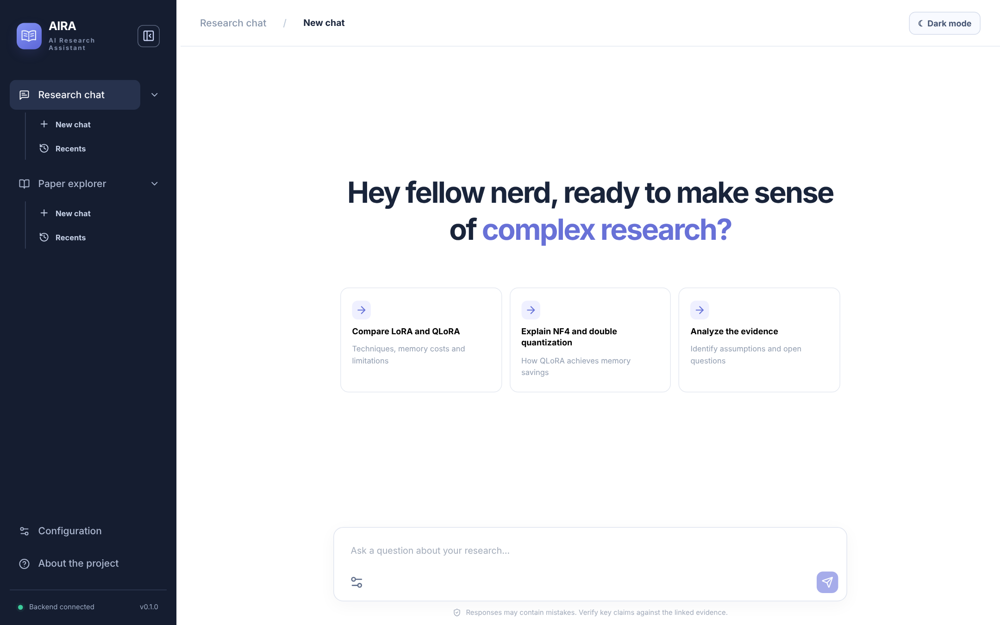
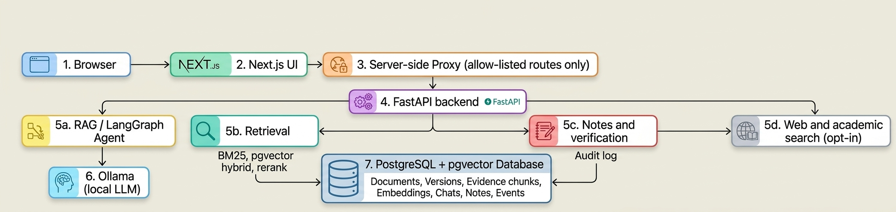

# AIRA: A local retrieval-augmented AI Research Assistant

[](https://github.com/valentinsvelev/aira/actions/workflows/ci.yml)
[](https://codecov.io/gh/valentinsvelev/aira)
[](LICENSE)

[](https://github.com/valentinsvelev/desidrata)

AIRA is a local, retrieval-augmented research assistant for working with scientific literature. Ask questions about your own PDF library and, when you allow it, the web and academic databases. Every answer cites the exact passages it used, down to the page, and you can open each source to check it. Everything runs on your machine: local models through Ollama, PostgreSQL with pgvector for storage, and no paid API or cloud account.

> **Status:** 0.1.0, a research prototype for a single local user. There is no authentication, so keep it on `localhost`.



## Features

- **Chat with your papers.** Choose *RAG* (fixed retrieve-then-answer, fast and reproducible) or *Agentic RAG* (a LangGraph agent decides which tools to call and can search again). Answers carry numbered citations that resolve to page-level passages; citations the model invents are marked as unverified.
- **Retrieval you can compare.** Sparse BM25, dense embeddings in pgvector (MiniLM or GTE-large, in separate indexes) and hybrid reciprocal-rank fusion, with optional cross-encoder reranking. Every retrieval setting can be changed per request.
- **Web and academic sources, opt-in.** Free web search (DDGS, or Tavily with a key) with guarded page reading, plus metadata search on arXiv, OpenAlex and Crossref (ACL Anthology, ACM DL). Supported open-access PDFs can be imported into your library after you approve them.
- **Paper Explorer.** Ask a literature question and get a synthesised answer over retrieved papers, with abstract-only sources clearly labelled. Specialised research models (DR Tulu, AstaBrief) can be plugged in via vLLM.
- **Verified research notes.** Notes must quote a source passage and are checked against it (embedding similarity plus number checks, or an experimental classifier) before they are saved. Every edit is logged, and notes are flagged when their source document changes.
- **Conversation memory.** Older turns of a chat can be searched and cited separately, so "what we discussed" is never confused with what a paper says.
- **Research agents and workflows.** Save agents with their own instructions, tool permissions and model settings, or build bounded workflows visually (parallel retrieval, evidence gates, loops with hard limits).
- **Evaluation built in.** Retrieval evaluation on BEIR SciFact (Recall@k, MRR, nDCG, latency), small-sample QA benchmarks (QASPER, DRUID or your own file) and DuckDB analytics over saved runs.
- **Inspectable.** Optional OpenTelemetry tracing to a local Phoenix instance, shown in the app as a *Behind the scenes* timeline. Prompts and documents are only recorded if you switch that on.

## How it works



Ingestion is incremental: each PDF is hashed, unchanged files are skipped, and a changed file becomes a new document version while old citations keep pointing at the exact text they used. Details are in [docs/architecture.md](docs/architecture.md).

## Quickstart

You need [Docker](https://docs.docker.com/get-docker/) with Compose and [Ollama](https://ollama.com/) running on your machine.

```sh
git clone https://github.com/valentinsvelev/aira.git
cd aira
cp .env.example .env             # then set POSTGRES_PASSWORD in .env
ollama pull qwen3.5:4b           # answer model
ollama pull qwen3.5:0.8b         # small model for chat titles
mkdir -p papers                  # put your PDFs here
docker compose up --build -d
./scripts/smoke.sh               # checks the API, database, UI and Ollama
```

Open <http://localhost:3000> and go to **Configuration → Your library → Sync folder** to index your PDFs. The API documentation is at <http://localhost:8000/docs>.

The first build downloads the Python ML stack and takes a while. If the smoke test cannot reach Ollama from Docker, see [docs/docker.md](docs/docker.md#connecting-to-ollama).

To try AIRA without your own papers, `make demo-up` starts an isolated demo on <http://localhost:3100> with synthetic documents, a saved agent and an evaluation run (see [demo/README.md](demo/README.md)).

## Using AIRA

**In the browser**

| Page | What it is for |
|---|---|
| Research chat | Questions over your library. The settings button chooses RAG or Agentic RAG, the research agent, and whether web and academic search are allowed. |
| Paper explorer | Literature questions answered from academic search results. |
| Configuration → Your library | Upload PDFs or sync the `papers/` folder. |
| Configuration → Research agents | Instructions, tool permissions, model settings and visual workflows. |
| Configuration → RAG systems | Saved retrieval and generation presets. |
| Configuration → Evaluation and Debugging | Retrieval evaluation, benchmark experiments and the *Behind the scenes* trace view. |

**From the command line**

```sh
docker compose exec api aira ingest
docker compose exec api aira index-embeddings
docker compose exec api aira search "NF4 quantization" --mode hybrid --top-k 5
docker compose exec api aira answer "How does QLoRA save memory?"
docker compose exec api aira ask "Compare LoRA and QLoRA" --web --academic
docker compose exec api aira academic-search "retrieval augmented generation" --year-from 2024
```

Run `docker compose exec api aira --help` for all commands.

## Configuration

All settings live in `.env`; [.env.example](.env.example) lists every option with its default. The most common ones:

| Setting | Default | Purpose |
|---|---|---|
| `OLLAMA_MODEL` | `qwen3.5:4b` | Default answer model |
| `RETRIEVAL_MODE` | `sparse` | `sparse`, `dense` or `hybrid` |
| `EMBEDDING_MODEL` | `sentence-transformers/all-MiniLM-L6-v2` | Model for dense and hybrid retrieval |
| `FAITHFULNESS_MODE` | `semantic` | How notes are checked: `semantic`, `extractive` or `tev1` |
| `WEB_SEARCH_PROVIDER` | `ddgs` | `ddgs`, `tavily` or `disabled` |
| `OTEL_TRACES_ENABLED` | `false` | Send traces to the local Phoenix container |

Recreate the API container after changing `.env` (`docker compose up -d api`).

## Development

The development stack mounts the source code into the containers, so Python and TypeScript changes reload without rebuilding images:

```sh
make dev         # start with hot reload
make dev-logs    # follow API and web logs
make dev-down    # stop (keeps all data)
```

Tests run offline, without Ollama, a GPU or downloaded models:

```sh
python -m pip install -e '.[dev,postgres,observability,web]'
make lint            # ruff
make test-backend    # pytest
make coverage        # pytest with a coverage report
cd web && npm ci && npm test && npm run typecheck
```

CI runs the same checks plus a migration check against PostgreSQL and a production build of the frontend. See [docs/development.md](docs/development.md) for running without Docker, database migrations and the project layout.

## Documentation

- [Architecture](docs/architecture.md): components, data model, retrieval and verification
- [Docker setup](docs/docker.md): Ollama connectivity, data volumes, troubleshooting
- [Development](docs/development.md): hot reload, running natively, tests, migrations
- [Operations](docs/operations.md): preflight checks, backups, password rotation
- [Evaluation](docs/evaluation.md): retrieval evaluation, benchmarks, analytics
- [Conversation memory](docs/conversation-memory.md): how chat history is searched and routed
- [Tracing](docs/tracing.md): OpenTelemetry and Phoenix, privacy settings
- [Roadmap](docs/roadmap.md)

## Citation

If you use this project in your research, please cite it.

You can use GitHub's "Cite this repository" button to generate a citation in APA or BibTeX format.

For BibTeX, you can use:

```bibtex
@software{velev2026aira,
  author = {Valentin Velev},
  title = {AIRA: A local retrieval-augmented AI research assistant},
  year = {2026},
  version = {0.1.0},
  url = {https://github.com/valentinsvelev/desidrata
}
```
